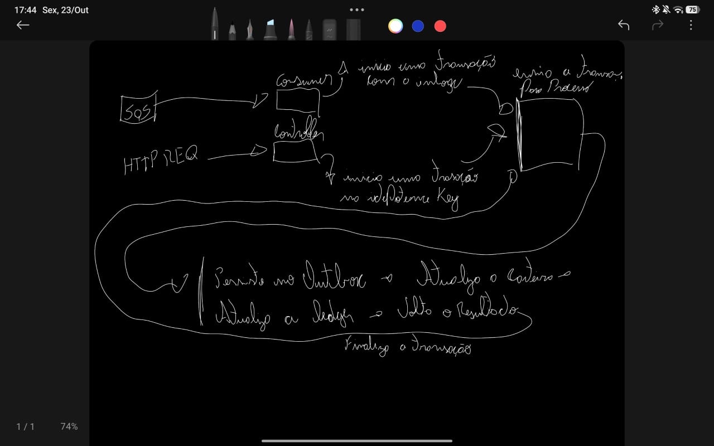
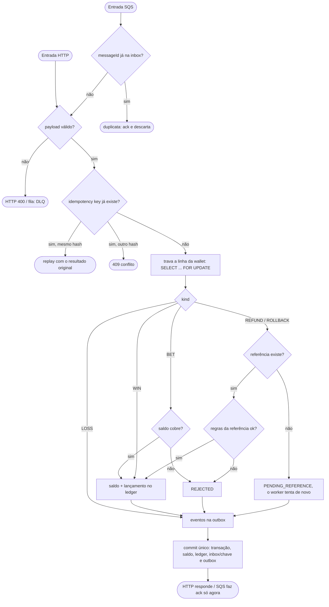

# Wagering Processor

Minha solução para o desafio técnico da Jungle Gaming: um serviço que recebe transações de aposta (`BET`, `WIN`, `LOSS`, `REFUND`, `ROLLBACK`) por HTTP e por SQS e mantém saldo e ledger corretos mesmo com mensagem duplicada, fora de ordem e várias instâncias rodando ao mesmo tempo.

Stack: Bun, TypeScript, NestJS, PostgreSQL, MikroORM, SQS (LocalStack) e Docker Compose.

## Como pensei

Antes de escrever código, rabisquei no tablet o caminho de uma transação. A ideia central já estava ali: as duas entradas (consumer da fila e controller HTTP) abrem uma transação, uma com a inbox e a outra com a idempotency key, chamam o mesmo processamento, e tudo (outbox, saldo, ledger) é confirmado num commit só.



Depois passei isso a limpo no Miro, quebrando em etapas e marcando o que ainda faltava decidir. Abaixo está a versão final, já com as decisões que tomei:



As decisões que eram minhas (o que o enunciado deixou em aberto) estão no [ARCHITECTURE.md](ARCHITECTURE.md).

## Rodando

Precisa de Docker e Bun 1.x.

```bash
docker compose up --build
```

Isso sobe o Postgres (porta 5433), o LocalStack (4566, já com as filas), roda a migration e inicia três instâncias da aplicação, nas portas 3000, 3001 e 3002. Para conferir:

```bash
curl localhost:3000/health/ready
```

Criar uma wallet e apostar:

```bash
curl -X POST localhost:3000/wallets -H 'content-type: application/json' \
  -d '{"playerId":"0192f28f-5dc0-7d58-bdb2-814ad6a0f4a1","initialBalance":{"amount":"100.00","currency":"BRL"}}'

curl -X POST localhost:3001/wagering/transactions -H 'content-type: application/json' \
  -H 'Idempotency-Key: provider-a:tx-1' \
  -d '{"providerId":"provider-a","externalTransactionId":"tx-1","playerId":"0192f28f-5dc0-7d58-bdb2-814ad6a0f4a1","walletId":"<id da wallet>","roundId":"r1","gameId":"fortune-chimp","kind":"BET","money":{"amount":"25.00","currency":"BRL"}}'
```

Para rodar a aplicação fora do Docker (usando o Postgres e o LocalStack do compose):

```bash
docker compose up -d postgres localstack
cp .env.example .env
bun install
bun run migrate
bun run start
```

## Testes

Os testes de integração usam Postgres e LocalStack de verdade, sem mock. Basta deixar os dois de pé:

```bash
docker compose up -d postgres localstack
bun test
```

Também dá para rodar separado: `bun run test:unit` (não precisa de nada de pé) e `bun run test:integration`.

Cada execução recria um banco `wagering_test` e cria filas próprias, então os dados de desenvolvimento ficam intactos. Com `TEST_LOGS=1`, os logs da aplicação aparecem durante os testes.

O que eu quis cobrir, além das regras de negócio:

- a mesma aposta 50 vezes em paralelo gerando um único débito;
- duas apostas de 80.00 disputando 100.00, o cenário da seção 8;
- três processos da aplicação ao mesmo tempo, e um deles morto com `SIGKILL` no meio do tráfego;
- processo morto depois do commit e antes do ack, e depois do commit e antes de publicar o evento. Para acertar esse ponto exato sem colocar gancho no código, coloquei um proxy entre a instância e o SQS que segura a chamada certa;
- Postgres e SQS fora do ar de verdade (também por proxy), conferindo o `503`, o retry e que nada se perde;
- REFUND e ROLLBACK chegando antes da aposta;
- dois publishers na mesma outbox;
- a limpeza da inbox e das idempotency keys sem reabrir duplicidade.

Todo arquivo de integração termina conferindo que o saldo de cada wallet bate com a soma do ledger.

## Endpoints

| Rota | |
|---|---|
| `POST /wallets` | cria a wallet (saldo inicial gera um `OPENING` no ledger) |
| `GET /wallets/:id` | saldo e version |
| `GET /wallets/:id/ledger?cursor=&limit=` | lançamentos, paginados por cursor |
| `POST /wallets/:id/reconciliation` | compara o saldo com o ledger |
| `POST /wagering/transactions` | submete uma transação (header `Idempotency-Key`) |
| `GET /wagering/transactions/:id` | consulta pelo id interno |
| `GET /providers/:providerId/wagering/transactions/:externalId` | consulta pelo id do provedor |
| `GET /health/live`, `GET /health/ready` | health checks |
| `GET /metrics` | métricas no formato Prometheus |

## Estrutura

```
src/
  shared/     Money, eventos, outbox, inbox, transação, observabilidade, SQS
  wallet/     wallet, ledger, criação, reconciliação
  wagering/   transação de aposta, use case, consumer, workers
test/
  unit/  integration/  concurrency/  support/
```
